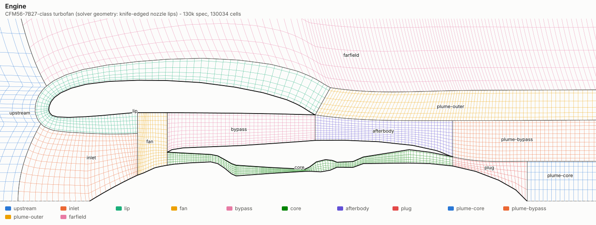
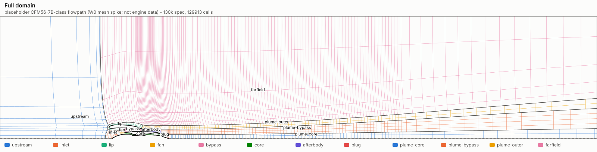
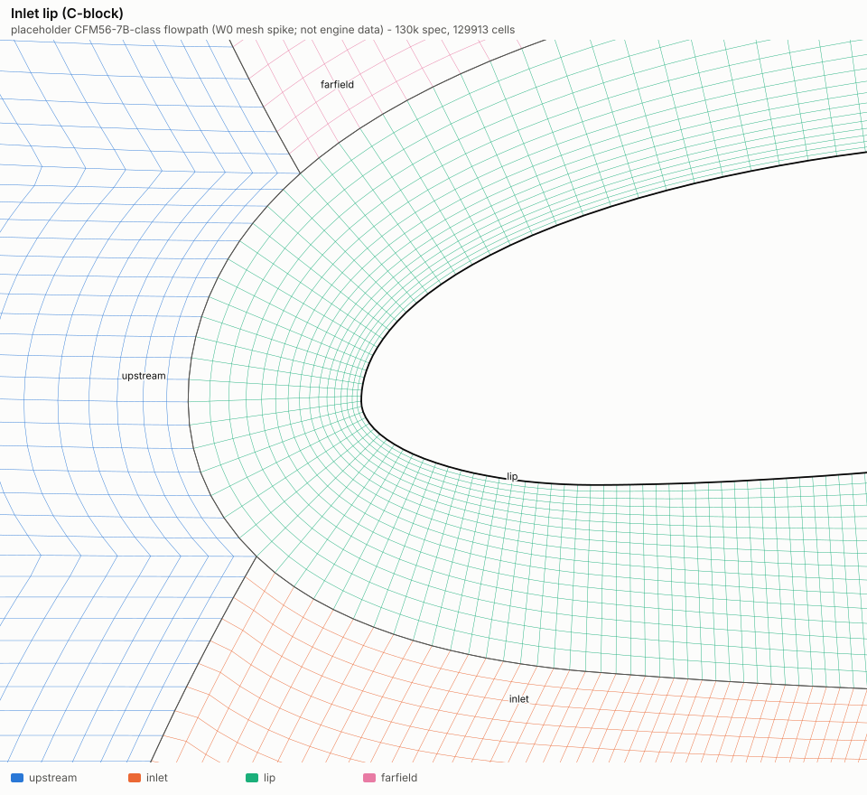
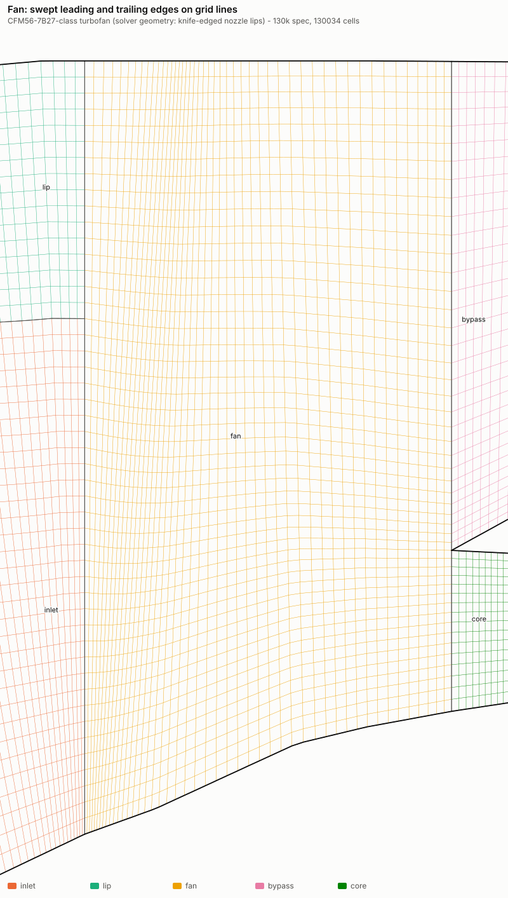
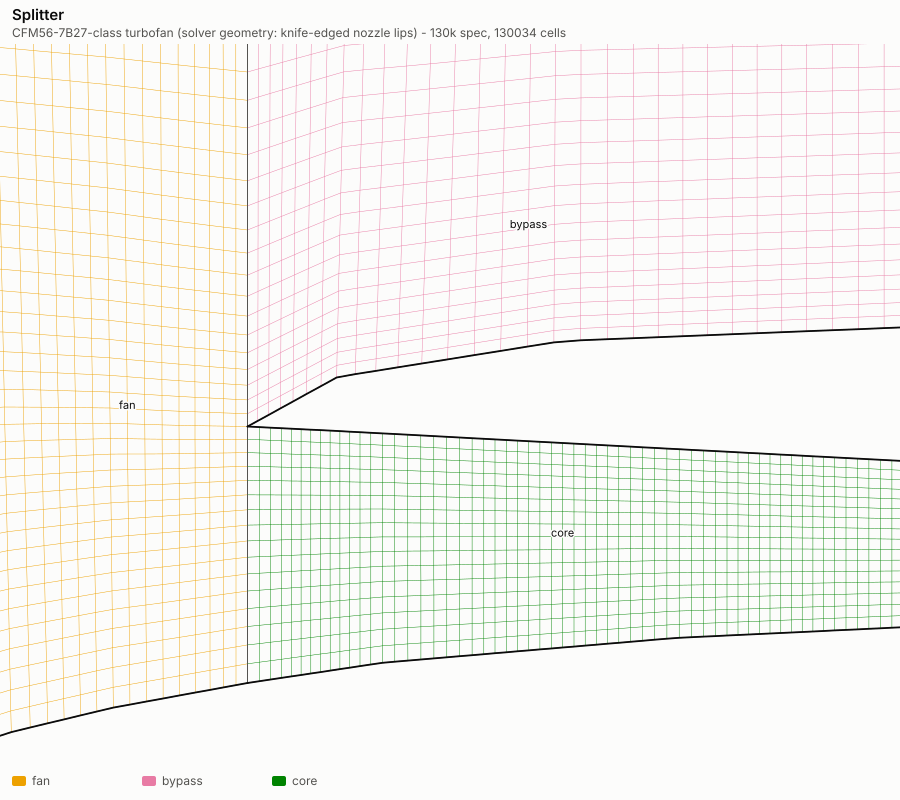
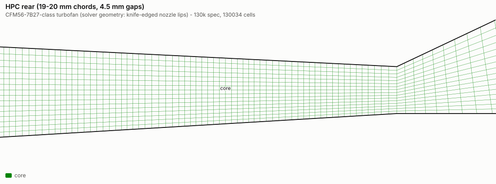
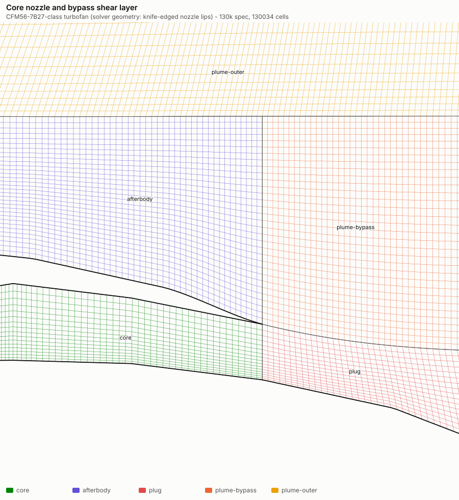
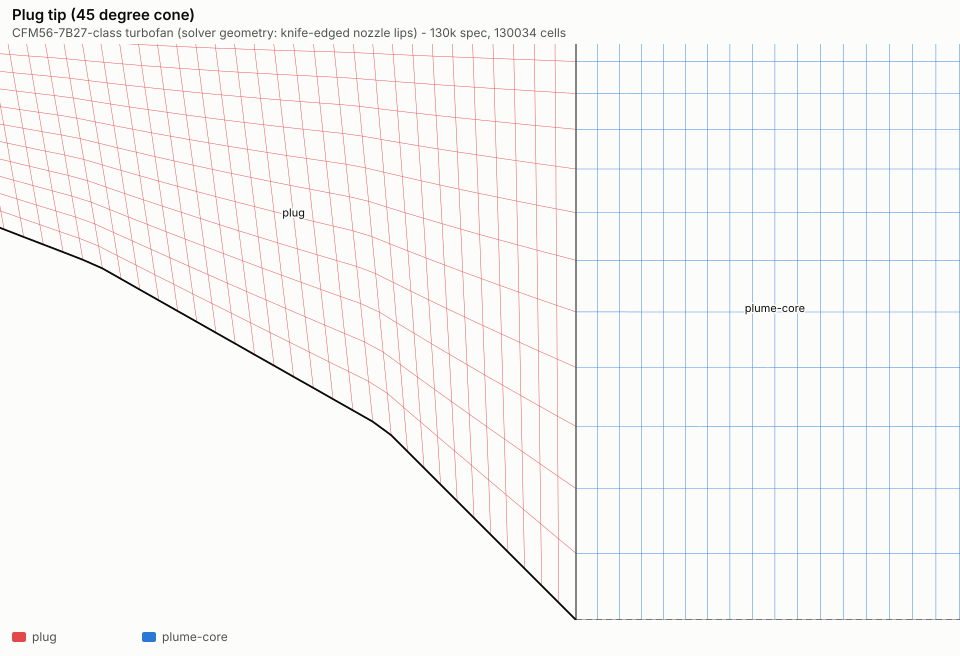
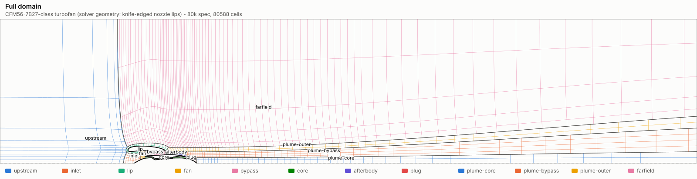
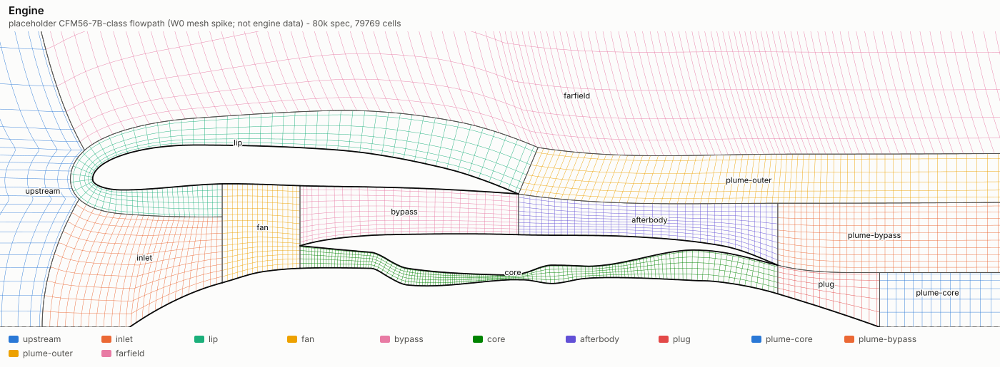

# Flow-solver mesh (W1: production mesh on the real engine definition)

The live flow solver runs on a 2D axisymmetric (x, r) plane with swirl, on a body-fitted, point-matched,
12-block structured mesh. This document describes the production mesh as W1 builds it on the real
`EngineDefinition` (`src/engine/definition.ts`, figures in `docs/ENGINE_FACTS.md`). W0 proved the topology
on a placeholder flowpath, which is now gone.

- **Code:** `tools/mesh/`.
  - The builder is `engineMesh.ts`, with specs `MESH_130K` (production) and `MESH_80K` (fallback).
  - The adapter from the definition is `geometry/definition.ts`.
  - The building blocks are distributions, curves, wall spacing with fixed lines (`build.ts`), TFI, the smoother, topology checks, metrics, the ghost map, the binary format, SVG output and the report.
- **Regenerate:** `npm run mesh`.
  - It writes the SVGs and `metrics-<spec>.json` in `docs/mesh/`, and the binary assets in `public/mesh/`.
  - `npm run mesh:assets` writes only the assets; it runs before `npm run dev` and `npm run build`.
  - Plain Node 24 with `tools/mesh/ts-resolve.mjs`; no dependencies.
- **Tests:**
  - `tests/unit/mesh/` (in `npm test`, under 1 s): the building blocks and the adapter, plus the engine topology at a coarse smoke resolution.
  - `tests/mesh/` (`npm run test:mesh`, part of `npm run gates`, about 1.2 s): both production meshes against every requirement below, and the asset hash.
- **Conventions:** SI units; x is axial, with x = 0 at the fan face (station 2) and positive downstream; r ≥ 0. Every block is right-handed in (x, r).

## Requirements and how they are met

| Requirement | 130k | 80k | Where it is checked |
|---|---|---|---|
| 12 blocks, point-matched, axis at r = 0 | interfaces bitwise (nodes and face vectors) | same | `validateMesh`; requirements suite |
| 16 cells across the core, 48 across the fan, 32 across the bypass | 16 / 48 / 32 | same | wall-to-wall at every duct column |
| ≥ 4 cells per blade chord (the definition's rows) | 8 to 29 (HPC rear 8) | 6 to 29 | blade-row zones, and an independent count of cell centres between the edges |
| Every blade LE/TE is a grid line; body-force zones are whole cells | 38 rows | same | edge nodes on the edge line to 1e-12; cells inside, neighbours outside |
| Stations 2, 13, 18, 25, 3, 4, 45, 49.5, 5, 8 are exact radial grid lines | 10 stations | same | node x bitwise equal to the station x; end nodes on the walls |
| Plume Δr 8 to 10 mm at both lips | 9.0 mm inside and outside both lips | same | `lipSpacing` |
| ≥ 5 D upstream and radially | 5.01 D from the highlight; r_out = 5.69 D | same | domain test |
| About 20 D downstream | 20.01 D from the core lip | same | domain test |
| Stretching ≤ 1.15 everywhere, including across interfaces and at the plug tip | max 1.140 (plug tip 1.140) | max 1.146 | `meshQuality().maxStretch` |
| Positive Jacobian at every cell corner | min 2.61e-6 m² | min 2.77e-6 m² | `meshQuality().minJacobian` |
| Total 130k ± 5 % / 80k ± 5 % | 130,034 (+0.03 %) | 80,588 (+0.7 %) | count test |

D = 1.5494 m, the fan diameter: the fan rotor's tip radius in the definition, ×2.

## Real geometry: the adapter

`flowpathFromDefinition` turns the definition's curves into the mesher's five named curves:
- hub = spinner ⊕ coreInner ⊕ plug, joined at bitwise-equal shared points;
- coreOuter, coreCowl, nacelleInner and nacelleOuter one to one;
- the blade rows, each with its leading and trailing edge extended from wall to wall of its duct;
- the solver's reduction stations (contracts `SOLVER_REDUCTION_STATIONS`, plus 49.5);
- the combustor extent.

**Knife-edge closure (decision D1-4, W0M-I1).**
- **The problem:** the definition's nozzle lips have blunt bases (the core cowl is 15 mm thick at its trailing edge, the nacelle 18 mm). The 12-block topology needs a knife edge at each lip.
- **What the adapter does:** it closes each base onto the duct-side line with a C1 smoothstep ramp over `KNIFE_EDGE_LENGTH_FACTOR` = 10 base thicknesses (150 mm at the core lip, 180 mm at the fan lip).
- **Stated tolerance:** the closure moves only the external line (coreCowl, nacelleOuter), only over the last 10 base thicknesses, and only inwards. It moves it by at most the base thickness (15.0 / 18.0 mm), and the line keeps falling to the lip.
- **What stays exact:** the duct-side lines coreOuter and nacelleInner are bitwise the definition's. So the nozzle exit areas A8 and A18 that the cycle is sized on (D1-2) are unchanged.
- **Rendering:** the definition keeps its true thickness, and the 3D geometry renders that.
- **Tests:** `tests/unit/mesh/definitionGeometry.test.ts` checks all of the above.

**Polyline walls.** The definition's curves are coarse polylines with kinks of up to 28° (for example at the combustor inlet). The mesher keeps every wall node exactly on them. It does not round the vertices: rounding by a few millimetres would change station-plane annulus areas by up to 10 % in the 25 mm HPC-exit annulus. Instead, every construction spaces its wall nodes by arc length:
- the ducts, by per-wall spacing;
- the plug, by arc-length wall nodes;
- the C-block, which already did.

## Blocks and connectivity

The topology is W0's (decision D1):
- a C-block around the nacelle, with valence-5 points P1/P2 where its smoothed outer-edge normal turns ±45° from the highlight;
- one H-block core from the splitter to the core-nozzle exit;
- three plume blocks bounded by the bypass and core shear lines;
- a far field above the C-block and plume-outer;
- upstream and inlet blocks in front.

| Block | What it covers | i direction | j direction (cells) |
|---|---|---|---|
| upstream | inflow to the face in front of the inlet lip, axis to r_out | downstream | axis to r_out (inlet 32 + C-block arc + far field 36) |
| inlet | inside the inlet, axis and spinner up to the C-block, to the fan face | downstream | radial (32) |
| lip | C-block: fan face, inner wall, highlight, outer wall, bypass lip | along the wall | wall-normal (16) |
| fan | fan face to the splitter plane | downstream | hub to casing (48) |
| bypass | splitter plane to the bypass-nozzle exit (station 18) | downstream | cowl to nacelle (32) |
| core | splitter plane to the core-nozzle exit (station 8) | downstream | hub to core outer wall (16) |
| afterbody | over the core cowl, bypass exit to the core-nozzle exit plane | downstream | cowl to bypass shear line (32) |
| plug | over the plug, core-nozzle exit to the plug tip | downstream | plug to core shear line (16) |
| plume-core / plume-bypass / plume-outer | the jets and the outer shear layer, to x_out | downstream | 16 / 32 / 16 |
| farfield | above the C-block's outer leg and plume-outer, to r_out | downstream | 36 |

There are nineteen interface pairs, stored once per side, with face vectors bitwise equal (min/max face pairs) or bitwise negated (max/max). The station planes and the duct-block boundaries are fixed interfaces; the rest are "floating", which only matters if smoothing is ever switched on.

## Station map and blade-row zones (decision D1-6, W0M-I4)

`EngineMesh.stations` gives each reduction station as a grid line: block and i-face index, across all j of that block. `EngineMesh.rows` gives each blade row's body-force zone: block and cells i0..i1−1, across all j. Both are in the binary asset (sections STATIONS and ROWS).

| Station | x (m) | Block | i (130k) | i (80k) |
|---|---|---|---|---|
| 2 fan face | 0 | fan | 0 | 0 |
| 13 fan exit, bypass | 0.600 | bypass | 34 | 31 |
| 18 bypass nozzle | 1.550 | bypass | 115 (= ni) | 96 (= ni) |
| 25 HPC inlet | 0.860 | core | 111 | 98 |
| 3 HPC exit | 1.460 | core | 316 | 262 |
| 4 combustor exit | 1.740 | core | 360 | 305 |
| 45 LPT inlet | 1.970 | core | 401 | 340 |
| 49.5 EGT plane (LPT N2 LE) | 2.065 | core | 424 | 357 |
| 5 LPT exit | 2.370 | core | 493 | 407 |
| 8 core nozzle | 2.750 | core | 534 (= ni) | 447 (= ni) |

**Blade-row zones.** The zones (130k cells per zone, then 80k) are:
- fan 29 / 29 (its edges are swept);
- fan OGV 9 / 7;
- booster rows 8 / 6–8;
- HPC rows 8–11 / 6–9;
- HPT 8 / 6–7;
- LPT 8–9 / 6.

The full lists are in `docs/mesh/metrics-<spec>.json`.

**How the lines are placed (decision D9).** Each duct block (fan, bypass, core) is built from straight cuts between its walls.
- **Fixed lines:** each cut is either a fixed line (a station plane, a blade edge, or a block end) or a free cut.
- **Per-wall spacing:** each wall is spaced along its own arc length (`wallRows`/`wallSpacing` in `build.ts`), with the same cell count per segment between fixed lines, and node i of one wall joins node i of the other. This makes:
  - every fixed line exact (radial lines bitwise);
  - wall kinks unable to jump the spacing;
  - the fan's swept edges honoured on both walls (the leading edge is 5 mm behind the fan face at the hub and 20 mm at the tip, 4:1).
- **Graded spacing:** within a wall the spacing is graded at `gradation` (8 %):
  - from node spacings that short segments fix (a 4.5 mm HPC gap is one 4.5 mm cell);
  - around a node coarser than the resolution target;
  - into interior caps found by bisection when the opposite wall needs more cells.
- **Shared counts:** they start from each wall's own needs and are raised until both walls can hold them.
- **Blade chords** keep at least max(4, ⌈0.75 × cellsPerChord⌉) cells: 6 at 130k, 5 at 80k. At 80k the fan OGV, booster S3, several HPC rows and all the LPT rows sit at the 6-cell floor (the 6-cells-per-chord spec rounds down to 6 in the shorter rows).

## Boundary conditions

The BC codes are part of the binary format and are never renumbered (`tools/mesh/types.ts`): 0 interface, 1 slip wall, 2 axis, 3 far field, 4 inflow, 5 outflow.
- **Walls:** `hub` (spinner, fan, core, plug), `core-outer`, `core-cowl` (bypass, afterbody), `nacelle-inner` and `nacelle-outer`.
- **Axis:** upstream.jmin, the part of inlet.jmin in front of the spinner nose, and plume-core.jmin.
- **Far field:** upstream.jmax and farfield.jmax.
- **Inflow:** upstream.imin.
- **Outflow:** the imax faces of the three plume blocks and of the far field.

Wall nodes lie on their geometry curves to within 1e-9 m; tests check every wall patch.

## Cell counts

| Block | 130k ni × nj | 130k cells | 80k ni × nj | 80k cells |
|---|---|---|---|---|
| upstream | 42 × 97 | 4,074 | 42 × 96 | 4,032 |
| inlet | 87 × 32 | 2,784 | 87 × 32 | 2,784 |
| lip | 252 × 16 | 4,032 | 250 × 16 | 4,000 |
| fan | 47 × 48 | 2,256 | 47 × 48 | 2,256 |
| bypass | 115 × 32 | 3,680 | 96 × 32 | 3,072 |
| core | 534 × 16 | 8,544 | 447 × 16 | 7,152 |
| afterbody | 127 × 32 | 4,064 | 98 × 32 | 3,136 |
| plug | 68 × 16 | 1,088 | 52 × 16 | 832 |
| plume-core | 823 × 16 | 13,168 | 390 × 16 | 6,240 |
| plume-bypass | 891 × 32 | 28,512 | 442 × 32 | 14,144 |
| plume-outer | 1018 × 16 | 16,288 | 540 × 16 | 8,640 |
| farfield | 1154 × 36 | 41,544 | 675 × 36 | 24,300 |
| **total** | | **130,034** (+0.03 %) | | **80,588** (+0.7 %) |

**Where the cells go.**
- The engine internals (inlet, lip, fan, bypass, core, afterbody, plug) hold 26k cells at 130k.
- The three plume blocks hold 58k, and the far field 41.5k (32 %).
- Point matching drives this: every plume x-station continues up through plume-outer and the far field, so each station costs 16 + 32 + 16 + 36 = 100 cells (R5 below).
- The 130k spec spends its extra cells on 8 cells per chord against 6, 8 mm axial cells at the nozzle lips against 10 mm, and a 25 mm axial plume plateau to 11 D against 50 mm to 7 D.

## Quality

The unsmoothed algebraic grid is the production grid (decision D3, D0-6). The definitions of every metric are in `metrics.ts`:
- Jacobian: the corner cross product of the two edges at each corner;
- scaled Jacobian: the minimum sine of the corner angles;
- stretching: the ratio of adjacent cell lengths along a grid line, between face midpoints, including across every interface;
- skew: the largest deviation of a corner angle from 90°;
- wall and interface orthogonality;
- kink: the change of direction of a grid line crossing an interface;
- aspect ratio.

The W0M-I2/I3 tests pin each of these on small blocks with known answers.

### 130k

| Block | min J (m²) | max J (m²) | min scaled J | max stretch | max skew (°) | wall ortho (°) | iface ortho (°) | kink (°) | aspect | edge min–max (m) |
|---|---|---|---|---|---|---|---|---|---|---|
| upstream | 1.23e-4 | 5.53e-1 | 0.64 | 1.136 | 50.0 | – | 50.0 | 45.7 | 1.0–84 | 8.35e-3–0.88 |
| inlet | 1.85e-5 | 5.06e-4 | 0.90 | 1.093 | 25.4 | 25.2 | 24.1 | 45.7 | 1.0–6 | 1.79e-3–0.03 |
| lip | 1.03e-5 | 6.64e-4 | 0.92 | 1.112 | 22.8 | 20.9 | 8.5 | 52.0 | 1.0–4 | 3.00e-3–0.03 |
| fan | 1.85e-5 | 1.07e-4 | 0.89 | 1.103 | 27.1 | 27.0 | 18.8 | 31.3 | 1.0–6 | 1.73e-3–0.01 |
| bypass | 2.57e-5 | 1.36e-4 | 0.87 | 1.110 | 30.1 | 30.0 | 28.6 | 31.3 | 1.0–3 | 4.98e-3–0.01 |
| core | 2.61e-6 | 1.13e-4 | 0.72 | 1.128 | 43.6 | 43.5 | 11.1 | 6.9 | 1.0–4 | 1.02e-3–0.01 |
| afterbody | 4.01e-5 | 9.93e-5 | 0.92 | 1.075 | 22.9 | 22.9 | 16.0 | 29.1 | 1.0–2 | 4.94e-3–0.01 |
| plug | 2.23e-5 | 3.20e-4 | 0.64 | 1.138 | 50.5 | 50.2 | 42.5 | 42.5 | 1.0–4 | 2.53e-3–0.03 |
| plume-core | 1.02e-4 | 7.34e-3 | 1.00 | 1.140 | 0.9 | – | 0.9 | 42.5 | 1.0–5 | 9.02e-3–0.16 |
| plume-bypass | 7.24e-5 | 7.32e-3 | 0.97 | 1.105 | 13.8 | – | 13.8 | 10.5 | 1.0–5 | 8.04e-3–0.16 |
| plume-outer | 6.85e-5 | 7.32e-3 | 0.91 | 1.105 | 24.3 | – | 24.2 | 52.0 | 1.0–5 | 7.25e-3–0.16 |
| farfield | 1.61e-4 | 6.68e-2 | 0.57 | 1.123 | 55.2 | – | 55.2 | 52.0 | 1.0–99 | 7.25e-3–0.88 |

### 80k

| Block | min J (m²) | max J (m²) | min scaled J | max stretch | max skew (°) | wall ortho (°) | iface ortho (°) | kink (°) | aspect | edge min–max (m) |
|---|---|---|---|---|---|---|---|---|---|---|
| upstream | 1.23e-4 | 5.53e-1 | 0.68 | 1.135 | 47.0 | – | 46.9 | 45.7 | 1.0–84 | 8.38e-3–0.88 |
| inlet | 1.85e-5 | 5.06e-4 | 0.90 | 1.093 | 25.4 | 25.2 | 24.1 | 45.7 | 1.0–6 | 1.79e-3–0.03 |
| lip | 1.03e-5 | 6.66e-4 | 0.92 | 1.112 | 22.8 | 20.9 | 8.5 | 52.0 | 1.0–4 | 3.00e-3–0.03 |
| fan | 1.85e-5 | 1.07e-4 | 0.89 | 1.103 | 27.1 | 27.0 | 18.8 | 31.3 | 1.0–6 | 1.73e-3–0.01 |
| bypass | 2.57e-5 | 1.68e-4 | 0.87 | 1.086 | 30.1 | 29.9 | 28.6 | 31.3 | 1.0–3 | 4.98e-3–0.01 |
| core | 2.77e-6 | 1.13e-4 | 0.73 | 1.146 | 42.9 | 42.8 | 11.1 | 6.9 | 1.0–4 | 1.02e-3–0.01 |
| afterbody | 5.00e-5 | 1.33e-4 | 0.92 | 1.075 | 22.9 | 22.9 | 16.2 | 29.1 | 1.0–3 | 4.94e-3–0.01 |
| plug | 2.80e-5 | 4.33e-4 | 0.64 | 1.146 | 50.4 | 49.9 | 42.5 | 42.5 | 1.0–4 | 2.53e-3–0.03 |
| plume-core | 1.38e-4 | 1.16e-2 | 1.00 | 1.140 | 0.9 | – | 0.9 | 42.5 | 1.0–7 | 9.02e-3–0.26 |
| plume-bypass | 9.10e-5 | 1.16e-2 | 0.97 | 1.105 | 13.8 | – | 13.8 | 10.5 | 1.0–7 | 9.00e-3–0.26 |
| plume-outer | 8.55e-5 | 1.16e-2 | 0.91 | 1.105 | 24.3 | – | 24.2 | 52.0 | 1.0–7 | 9.00e-3–0.26 |
| farfield | 2.01e-4 | 1.06e-1 | 0.57 | 1.124 | 55.2 | – | 55.1 | 52.0 | 1.0–80 | 9.05e-3–0.88 |

**Worst values and where they occur** (130k; 80k within 1 % except as noted):

| Metric | Value | Where | Why |
|---|---|---|---|
| Stretching | 1.140 (80k: 1.146) | plume-core at the plug tip (3.406, 0.336); 80k: core at the core lip | arc-length plug nodes against the axis cells behind the 45° tip |
| Skew | 55.2° | far field at O (1.59, 1.06) | the C-block's outer corner above the steep (27°) nacelle boattail |
| Wall orthogonality | 50.2° | plug, near the tip | arc-length plug wall nodes under x-spaced shear-line nodes lean the plug columns |
| Wall orthogonality in the ducts | 27–44° | station planes and blade edges at sloped or kinked walls (station 25 at the gooseneck exit, combustor inlet) | exact radial lines where the polyline walls slope |
| Smallest edge | 1.02 mm | core, HPC rear at the hub | 16 cells across a 22–25 mm annulus, clustered at the walls |
| Minimum Jacobian | 2.6e-6 m² | core, HPC rear | small cells, not a bad shape |
| Minimum scaled Jacobian | 0.57 | far field at O | as the skew |
| Aspect ratio | 99 (80k: 84) | top of the far field / far upstream | thin far-field cells under the plume x-stations |

**The explicit time step (D0-7) at the final resolution.**
- **Result:** 1.22 µs at 130k, at the HPC exit next to the hub (x = 1.447 m); 1.30 µs at 80k (x = 1.426 m).
- **Method:** `explicitDtLimit`, at CFL 1, as min 1/(a_x/L_i + a_r/L_j).
  - In the core, a_x = |c_x| + c and a_r = c, from the design-point mean line (`ENGINE_MEANLINE`).
  - Elsewhere, 650 m/s both ways.
- **Comparison:** W0's placeholder estimate was 1.4 / 1.6 µs. The real HPC rear has 1.02 mm radial cells at the hub, against the placeholder's 1.39 mm.
- **Physical-time mode** therefore needs about 1.2 µs, below the plan's 2 µs. That is about 40 % more wall time per simulated millisecond than 2 µs, in that mode only; tracking mode uses local time stepping.

## Pictures

`npm run mesh` regenerates all of these. Colours identify blocks; walls are black.

The 80k fallback:

## Binary format v2

The authoritative layout is in `tools/mesh/format.ts`. Writer → reader → writer round-trips bitwise; this is tested, and `npm run mesh` repeats it on both assets.
- **Layout:** little-endian. A 64-byte header, then the section table (16 bytes per section: u32 id, element type, byte offset, byte length), then the sections in id order.
- **Alignment:** each section starts on an 8-byte boundary, so a loader can view it in place as a typed array.
- **Element types:** 1 f64, 2 f32, 3 i32, 4 u8, 5 block record (64 B), 6 patch record (64 B), 7 station record (32 B), 8 row record (48 B).

**Header (64 bytes).**

| Bytes | Content |
|---|---|
| 0–7 | magic `TFMESH\0\0` |
| 8 | u32 version = 2 |
| 12 | u32 flags (bit 0: metrics are f32; nodes are always f64) |
| 16–44 | u32 counts: blocks, patches, nodes, cells, i-faces, j-faces, ghosts, ghost layers (2) |
| 48 | u32 number of sections (18) |
| 52 | u32 header bytes (64) |
| 56 | u32 total file bytes |
| 60 | reserved |

**Sections.**

| Id | Section | Element | Indexing |
|---|---|---|---|
| 1, 2 | BLOCKS, PATCHES | records | as v1 |
| 3, 4 | NODE_X, NODE_R | f64 | `nodeOffset + j·(ni+1) + i` |
| 5–8 | CELL_X, CELL_R, CELL_AREA, CELL_VOLR | f64/f32 | `cellOffset + j·ni + i`; planar centroid, area, per-radian volume A·r_c |
| 9–11 | IFACE_NX, IFACE_NR, IFACE_AREAR | f64/f32 | `iFaceOffset + j·(ni+1) + i`; n·L towards +i, r̄·L |
| 12–14 | JFACE_NX, JFACE_NR, JFACE_AREAR | f64/f32 | `jFaceOffset + j·ni + i`; n·L towards +j, r̄·L |
| 15, 16 | GHOST_SRC, GHOST_BC | i32, u8 | the two-layer ghost map (as v1; no corner ghosts) |
| 17 | STATIONS | 32 B record | id (16 B, UTF-8, NUL-padded), u32 block, u32 i-face index, f64 x |
| 18 | ROWS | 48 B record | id (32 B), u32 block, u32 i0, u32 i1 (cells i0..i1−1, all j), 4 B reserved |

**Record layouts.**
- **Block record:** name (32 B), then u32 ni, nj, nodeOffset, cellOffset, iFaceOffset, jFaceOffset, ghostOffset.
- **Patch record:** u32 block, u8 face, u8 BC, u8 floating, u32 start, u32 end, i32 neighbour block, u8 neighbour face, u32 neighbour start and end, label (32 B).

**Decoder checks (W0M-N3).** The decoder rejects a file whose structure is inconsistent before anything uploads its indices:
- a section whose element type disagrees with the precision flag;
- block offsets that do not add up;
- patches with unknown blocks, faces or BC codes, or out-of-range node ranges;
- ghost sources outside the cells or unknown ghost codes;
- station or row maps outside their blocks.

**Discrete identity.** Σ n_r·r̄·L over a cell's faces equals the planar area A exactly (Green), which balances the radial pressure source p·A in a quiescent field (ladder L1). A metrics test checks it to 1e-12.

**Sizes.** At 130k the asset is 7.56 MB with f32 metrics and 12.8 MB with f64. At 80k it is 4.69 MB and 7.96 MB.

## The asset: generated, not committed (decision D10)

`npm run mesh` (or `mesh:assets`) writes `public/mesh/mesh-130k.bin` and `mesh-80k.bin`, both with f32 metrics. Both are git-ignored. The script also writes `public/mesh/manifest.json` (format, version, and per spec the file, bytes, cells, blocks and SHA-256), which is committed. `mesh:assets` runs before `npm run dev` and `npm run build`, so Vite serves and bundles the files.

**Why generate:**
- **Fast:** generation is deterministic and takes 0.5 s for both specs.
- **No churn:** committing 7.6 + 4.7 MB of binary that changes with every mesh or definition tweak would bloat the history with no review value.
- **Change control:** the manifest makes every mesh change visible in a diff. `tests/mesh/asset.test.ts` rebuilds both meshes and checks bytes, cell counts and SHA-256 against the manifest, so a nondeterministic or unintended change fails `npm run test:mesh`. When the mesh changes on purpose, rerun `npm run mesh` and commit the manifest.
- **Loader check:** the W2 loader should check the downloaded bytes against the manifest hash.

**Caveat:** the hash depends on V8's Math functions (Node 24). A different Node major version could change the last bits; the test would then say so.

## Decisions

- **D1 Topology:** W0's 12 blocks, unchanged.
- **D2 Station planes:** see D9; the W0 version covered only the fan face, splitter and nozzle exits.
- **D3 No elliptic smoothing in production (sweeps = 0; D0-6, D1-5).**
  - The algebraic construction meets every requirement on its own.
  - **The critic's pass-1 measurements** (300 Winslow sweeps, ω 0.8, Thomas–Middlecoff control, all blocks) are the record; the W0 numbers here did not reproduce (W0M-N1).
    - **Floating interfaces:** stretching reaches 3.83 at P2 and O, with lip skew up to 79.5°, and every Jacobian stays positive.
    - **Fixed interfaces:** stretching of 2.27–3.99 next to P1/P2, far-field skew 39.5° (from 46.3°), and stretching 1.49 at O.
    - The singular points P1, P2 and O stay pinned; the cells around them deteriorate.
  - **W1 added a corner-constrained case** (smoothing only plug and plume-core, with their shared interface floating and the plug tip pinned, ω 0.8), at the plug tip where the unsmoothed W0 construction reached 1.393:
    - 100 or 300 sweeps with boundary (Thomas–Middlecoff) control: 1.43–1.44;
    - pure Winslow: 2.35;
    - initial-grid control: 1.44.
  - Smoothing made it worse in every variant. The tip was fixed algebraically instead (D11). Smoothing stays off.
- **D4 Matching by construction.**
  - The W0 rules are kept: the shear-line spacing shared by both sides, the far field and inlet re-spaced to the neighbour's last cell, and the upstream block blended from smoothed copies of its east face.
  - **Fan face:** the inlet and the C-block take the fan block's first-cell widths at the fan face as their last axial spacing (1.7 mm at the hub, 6.6 mm at the casing). This matches the 4:1 wedge in front of the swept fan leading edge.
  - **C-block, at P1/P2:** the wall spacing is capped by (outermost cell thickness)/(outer-edge stretch). The outer edge is an offset curve, its normals are computed on a fine placement-independent sampling, and they are smoothed over 0.5 × the local C-block thickness. Without the cap the outer edge was 1.7 times the outer layer at P2, and the upstream and far field reached 1.40–1.41.
- **D5 Shear-layer spacing:** grows like (distance/length)² from 9 mm at the lips to 45 mm at the outflow (W0).
- **D6 Budgets:** as W0 (8 against 6 cells per chord, lip axial 8 against 10 mm, plume plateau 25 mm to 11 D against 50 mm to 7 D); nFar = 36.
- **D7 Domain extents** are rounded outwards to whole centimetres plus 1 cm: x_in = −8.54 m, x_out = 33.75 m, r_out = 8.82 m.
- **D8 No new dependencies.**
- **D9 Station planes and blade edges as grid lines (D1-6).** All ten reduction stations are exact radial lines, and every blade row's leading and trailing edge is a grid line (the fan's are swept). Ducts are spaced per wall with shared counts (see the station map section). Skew at a station plane that meets a sloped wall is the price of an exact plane: up to 44° at the gooseneck exit (station 25) and the combustor inlet.
- **D10 Generated asset with a committed hash** (above).
- **D11 Plug tip.**
  - **Cause:** the definition's plug ends in a 45° cone. With wall nodes at the shared plume x-stations, the wall cells were 1/cos 45° longer along the wall than the axis cells behind the tip: 1.393, the 1.39 the critic found.
  - **Fix:** the plug wall nodes are spaced by arc length, at the plume stations' fractions; the columns lean slightly. The plug's first-cell size is blended as a fraction of the column, not as an absolute size.
  - **Result:** plug and plume-core reach 1.138 / 1.140.
- **D12 Full-size meshes in their own suite.**
  - The production meshes are built and checked in `tests/mesh` (`npm run test:mesh`, in `npm run gates`).
  - The unit suite builds a 43k-cell smoke mesh of the same topology for structure and coverage.
  - This keeps `npm test` fast and stops mutation testing of `tools/mesh` from rebuilding production meshes for every static mutant.

## Open risks and notes for W2

- **R2 Explicit time step:** about 1.2 µs in physical-time mode (above).
- **R3 Skew and orthogonality without smoothing:**
  - 55° at O, the C-block's corner above the steep nacelle boattail;
  - 50° at the valence-5 points;
  - up to 44° at station planes on sloped walls.
  If the solver wants better, the options are singular-point-aware smoothing (free valence-5 points with a five-neighbour update) or fairing the C-block outer edge into plume-outer at O.
- **R4 Shear-line placement:** the shear lines are block boundaries shaped like jets, not computed jet boundaries.
- **R5 Far-field cost (the W0 finding "the far field takes 32 % of the cells"):** WONTFIX in W1.
  - **Why:** point matching runs every plume x-station through the far field (41.5k cells at 130k).
  - **The options**, each with a cost outside the mesher:
    - a patched, non-matching interface above plume-outer, freeing about 25–30k cells, but the ghost exchange stops being an index copy and loses exact conservation, and the binary format and solver change;
    - coarser plume stations far downstream (shear-layer resolution);
    - or nFar < 36, which needs far-field ratios above 1.123 and erodes the stretching margin.
  - Since the 130k budget is met with every requirement, this is a W2 performance call, not a mesh defect.
- **N4 Corner ghosts:** the ghost map still has none. Dimension-split MUSCL never reads them, but the v1 plume eddy viscosity and v2 k-ω need face cross-derivatives. W2/W3 add corner ghosts or build face gradients from the available cells.
- **I5 (contracts):** `FIELD_EXTENTS.far` covers r ≤ 10 m, and the mesh ends at r_out = 8.82 m. The contracts builder decides: either out-of-domain texels are defined as ambient, or the far extent is sized from the mesh.
